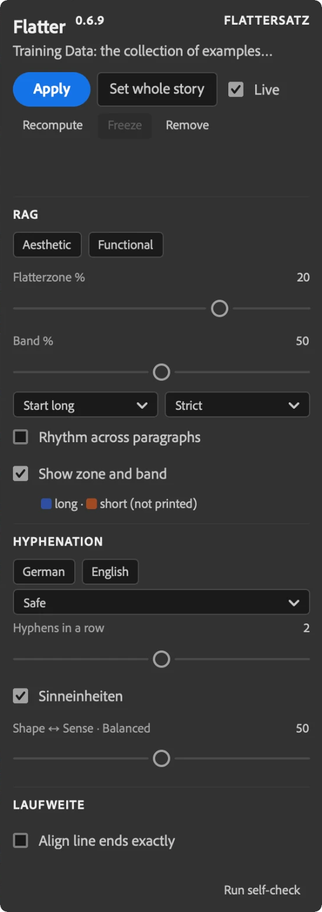

# Flatter



**Beautiful ragged text in InDesign, in one click.**

Flatter is a plugin for Adobe InDesign that gives left-aligned text (Flattersatz) an even, deliberate right edge. Pick a strict long, short, long, short rhythm (**Aesthetic**) or a calm rag tuned for reading (**Functional**). Flatter chooses every line break for you, hyphenates carefully, and keeps words that belong together on one line. German and English.

### [⬇ Download Flatter](https://github.com/nyannurs/rag-indesign-plugin/releases/latest/download/Flatter.ccx)

Version 0.6.9 · Mac · InDesign 2023 or newer

---

## Install (2 minutes)

You need **InDesign** and the **Creative Cloud app** (the app you installed InDesign with). Make sure you are signed in to it.

1. **Open InDesign once, then quit it.** (InDesign → Quit InDesign.)
2. **Double-click the file you downloaded** (`Flatter.ccx`, usually in your Downloads folder). The Creative Cloud app opens.
3. Creative Cloud says the plugin is not from the Adobe Marketplace. That is expected. **Click Install.**
4. **Open InDesign.** You find Flatter in the menu bar under **Plug-Ins → Flatter** (in older InDesign versions: **Plugins → Flatter**).

That's it. To update later, download the new version and double-click it the same way.

## Use

1. Click into a text frame (or select it).
2. Press **Apply**. Flatter sets the rag.
3. Move the sliders. The text changes as you drag.
   - **Flatterzone**: how far short lines may end from the right edge.
   - **Band**: how precisely lines hit their position.
   - **Align line ends exactly**: Flatter nudges letter and word spacing a tiny bit so every line ends exactly where it should.
4. Check the language under **Hyphenation** (**German** / **English**). The language decides where words may be divided.

**Long texts (many pages or columns):** select a few paragraphs with the Type tool and press **Apply**. Flatter then works only on those, so the sliders stay quick. When you like the result, press **Set whole story**: every paragraph gets the same settings in one go.

**Undo:** every action is a single Cmd+Z.

**Remove** takes Flatter off a story and puts every setting back the way it was.

## Sending files to others

Your file looks the same on computers without Flatter. If someone else will edit the InDesign file, press **Freeze** first: it fixes the line breaks so nothing shifts. **Unfreeze** brings back the editable rag. You don't need Freeze for PDF export.

Flatter never changes your words. Everything it needs to undo itself is stored inside your InDesign file, so **Unfreeze** and **Remove** still work after saving, reopening or editing the document.

## Something's not working?

**Nothing happens when I double-click the file.**
Install the Creative Cloud app from [adobe.com](https://www.adobe.com/creativecloud/desktop-app.html), sign in, open InDesign once, and try again.

**Creative Cloud shows a red "installation failed" message.**
Click **Details** on the message, copy the text, and [send it to us](../../issues/new).

**I can't find Flatter in InDesign.**
Quit InDesign completely and open it again. Then look under **Plug-Ins → Flatter** (in older versions: **Plugins → Flatter**).

**A pink box appears at the top of the panel.**
Flatter found something unusual in your InDesign. Press **Copy details** and [send it to us](../../issues/new).

**It's slow on a long story.**
Select a few paragraphs, press **Apply**, find your settings, then press **Set whole story** (see [Use](#use)).

**Some paragraphs are not changed.**
Centred and right-aligned paragraphs, like headings, are left alone on purpose.

## Uninstall

Open the Creative Cloud app → **Manage Plugins** (in the app's menu or under Stock & Marketplace) → Flatter → **•••** → **Uninstall**.

## Good to know

- Tested on Mac with InDesign 2026 and 2027. Windows should work but is untested.
- Not on the Adobe Marketplace yet, which is why Creative Cloud shows a warning when you install it.
- Found a bug or have an idea? [Open an issue](../../issues/new).

## Licence

Flatter is free. You may use it for any work, including paid client work, and pass it on to others. You may not sell it or use it to build a competing product. The legal text is the [PolyForm Shield License 1.0.0](LICENSE.md).

---

<details>
<summary>For developers</summary>

Requires Node 24 and npm.

```bash
npm install
npm test                # unit, property and snapshot tests
npm run typecheck
npm run playground      # browser playground with the same solver
npm run test:indesign   # integration tests in a running InDesign (throwaway documents)
npm run panel           # dev build "Flatter (dev)", runs beside the installed release
npm run package         # release build → dist/Flatter-<version>.ccx and dist/Flatter.ccx
```

| Folder | Contents |
|---|---|
| `packages/core` | line-break solver (pure TypeScript) |
| `packages/hyphenation` | patterns, German analyser, Sinneinheiten |
| `packages/indesign-adapter` | plan, steer, read back; InDesign DOM |
| `packages/panel` | the UXP panel |
| `packages/simulator` | SVG simulator and playground |
| `tools/indesign` | scripts and tests that run inside InDesign |

More: [plan](docs/plan.md), [progress log](docs/progress.md), [decisions](docs/decisions.md), [InDesign findings](docs/spike-results.md), working notes in `CLAUDE.md`. Licence: [PolyForm Shield 1.0.0](LICENSE.md); third-party licences: [THIRD_PARTY_NOTICES.md](THIRD_PARTY_NOTICES.md).

</details>
